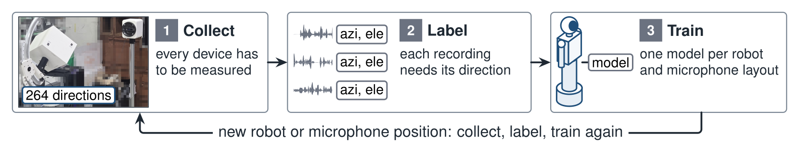
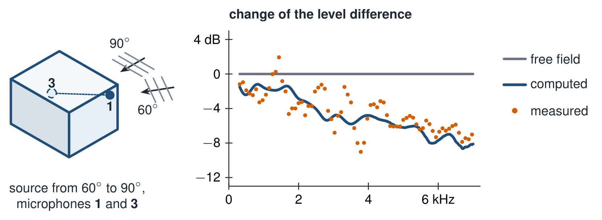
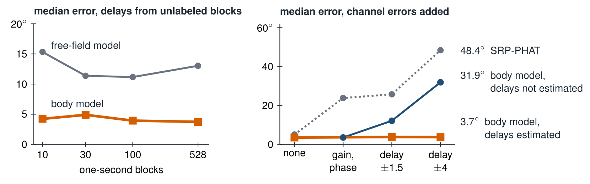

# Calibration-Free Sound Localization

Sound source localization on a robot body without measured responses, direction labels or manual channel calibration. The body's response is computed from its CAD geometry, the delays of the microphone channels are estimated from unlabeled audio, and the direction is found by matching, with no trained model. Research internship at the KIST AI and Robotics Institute, Humanoid Research Center (2026).



On recordings of a 3D-printed box with channel gains, phases and delays added in software, the median error is 3.7° with the delays estimated from unlabeled audio, against 48.4° for SRP-PHAT. On the public LOCATA recordings, a rigid-sphere model of the array body gives 5.8°, against 7.9° for a free-field model.

**Technical summary**

- **Body response from CAD.** Computed with the boundary element method (BEM) for every direction, with no acoustic measurement.
- **Pair-ratio matching.** The complex factor that each channel's constant gain and phase put on a microphone pair is removed in closed form.
- **Channel delays from unlabeled audio.** Pooled over one-second blocks; 10 blocks give a median error of 4.2°.
- **No trained model.** A new robot or microphone layout needs a new BEM table and unlabeled audio, not a new model.

## Problem and users

On a robot, the body changes the sound that reaches each microphone, so free-field models fit poorly, and the usual ways to get the body's response are costly (figure above). The device is measured, or a model is trained on recordings with known directions and retrained when the robot or the microphone positions change. On top of that, each channel of a real array has its own gain, phase shift and delay, which are calibrated by hand.

## Design requirements

- **No acoustic measurement.** The body's response comes from its CAD geometry.
- **No labels.** The channel delays come from recordings without known directions.
- **No training.** The direction is found by matching, so nothing has to be retrained for a new body.
- **Unknown channels.** Each channel's gain, phase and delay are unknown.

## System architecture


The dashed box is an existing tool, boxes with a solid colored outline are code in this repository, and gray boxes are inputs.

- **Existing tools and data:** BEM tables from [stl2bem](https://github.com/Kwon-Junhyeong/stl2bem), the public LOCATA corpus.
- **Developed for this project:** response extraction, block covariances, the pair-ratio scorer, the delay estimation from unlabeled blocks, and the experiments on the box and on LOCATA.

## Body responses from CAD



`build_replicas.py` takes the responses of the four microphones (called replicas in the code) from a BEM table of the body on a 5° grid of 2,664 directions. On a body, a change of direction changes the level difference between microphones as well as the delay. In the figure, the level difference between microphones 1 and 3 changes by up to 8.6 dB when the source moves from 60° to 90°; the free-field model predicts no change, and the computed response follows the measurement.

## Matching microphone-pair ratios

`build_blocks.py` splits a recording into one-second blocks and keeps the covariance of the speech frames of each block. For each of the six microphone pairs, `scorer.py` compares the measured ratio of the pair's cross-spectra with the computed ratio of the two microphones' responses, over frequency and for every direction. A gain and phase that are constant over frequency multiply a pair ratio by one complex number; the scorer uses the normalized correlation between the two ratios, which removes the best-fitting complex number in closed form, and averages the six residuals. The direction with the smallest residual is refined with a quadratic fit between grid points.

## Delays estimated without labels

A delay adds a phase that grows linearly with frequency, while a change of direction also changes the level differences and the shape of the pair ratios, so direction and channel delay can be separated. `self_calibration.py` works in three steps on the recording's own blocks:

1. For each block, a scorer that also searches over the delay of each pair picks the direction, and keeps the delay of each pair at that direction.
2. The channel delays stay fixed while the source direction varies, so the median of each pair's delay over the blocks gives six pair delays. Least squares turns them into one delay per microphone, with microphone 1 as the reference.
3. The delays are removed from the recording and the blocks are matched again with the pair-ratio scorer.

## Results

**Measured box.** A 3D-printed box with four microphones was recorded from 264 directions, and the first two one-second blocks of each recording are used (528 blocks). Gains, phases and delays of up to 4 samples were added to its channels in software (`unknown_channels.py`); each value is the mean over three random sets of channel errors. The error is the angle between the estimated and the true direction.

| Method | Median error, mean of three sets |
|---|---:|
| SRP-PHAT without calibration | 48.4° |
| Body model, delays not estimated | 31.9° |
| Free-field model, delays estimated from all 528 blocks | 13.0° |
| Body model, delays estimated from all 528 blocks | 3.7° |
| Body model, delays estimated from 10 random blocks | 4.2° |

Estimating the delays brings the body model from 31.9° to 3.7°. With delays estimated by the same procedure, the free-field model stays at 13.0°.



**LOCATA.** Task 1 of the public LOCATA recordings: 13 recordings, eight of the 32 capsules of a spherical microphone array, 109 one-second blocks. The same pair-ratio matching, without delay estimation, runs with two models of the array on a grid of 2° in azimuth and 3° in elevation.

| Model of the array | Median error |
|---|---:|
| Analytic rigid sphere | 5.8° |
| Free field | 7.9° |

The model of the array body gives a lower error than the free-field model. In the original experiment, a BEM table of the array, which is not included here, gave 5.7°.

## Repository structure

| Path | Contents |
|---|---|
| `build_replicas.py` | Microphone responses from a BEM table, 5° grid |
| `build_blocks.py` | One-second blocks and their covariances from the box recordings |
| `scorer.py` | Pair-ratio matching with the gain and phase of each pair removed |
| `self_calibration.py` | Channel delays from unlabeled blocks, then the directions |
| `unknown_channels.py` | Each matcher under added gains, phases and delays |
| `demo.py` | A check without data: the estimate when every channel has its own unknown gain and phase |
| `common.py` | Shared functions: channel errors added in software, scoring, the SRP-PHAT baseline, peak refinement, the error |
| `build_locata_blocks.py`, `locata.py` | Blocks from the LOCATA corpus; rigid-sphere and free-field matching |
| `docs/` | Figures |

## Setup and run

Software: Python 3 with the packages in `requirements.txt`. `demo.py` needs no input. The other scripts need a BEM table of the box from stl2bem, the box recordings and the LOCATA corpus.

```sh
pip install -r requirements.txt
python demo.py                             # no data: pair-ratio matching and a beamformer under unknown channels
python build_replicas.py BEM_TABLE.h5      # data/box_replicas_5deg.npz
python build_blocks.py RECORDINGS_DIR      # data/box_blocks.npz
python unknown_channels.py                 # each matcher under added gains, phases and delays
python self_calibration.py                 # delays from unlabeled blocks, then the directions
python build_locata_blocks.py LOCATA_DIR   # data/locata_blocks.npz from the LOCATA corpus
python locata.py                           # rigid-sphere and free-field matching on LOCATA
```
