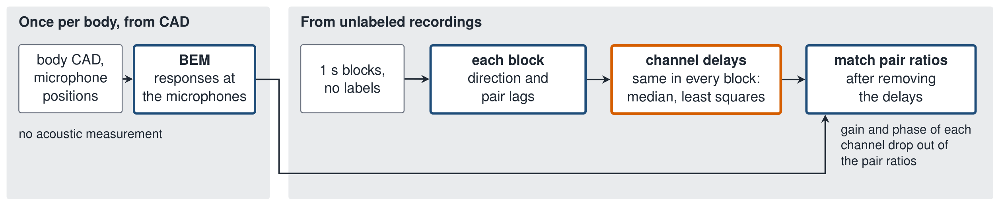

# Calibration-Free Sound Localization

Sound source localization on a robot body without manual calibration of the microphone channels. Every channel adds an unknown gain, phase and delay, and conventional calibration needs a known source or labeled recordings for each device. Acoustic data is hard to collect and label, so a CAD model of the body and unlabeled audio take their place. Research intern work at the KIST AI and Robotics Institute, Humanoid Research Center (2026).



## Body responses from CAD

The responses of the four microphones are computed from the body's CAD model with the boundary element method, with no acoustic measurement (`build_replicas.py`).

## Matching microphone-pair ratios

The recording is matched to the computed responses through the ratios between microphone pairs. A constant gain and phase on a channel drop out of these ratios, so they need no calibration (`scorer.py`).

## Delays estimated without labels

On a body, a change of direction is not just a delay, so direction and channel delay can be told apart. The channel delays are the same in every 1 s block while the source direction changes, so pooling the blocks recovers them without labels (`self_calibration.py`).

## Results

On a 3D-printed box with four microphones, measured from 264 directions:

- With unknown channel delays added, the median error is 3.7 degrees. SRP-PHAT without calibration gives 48.4 degrees (`unknown_delays.py`).
- From 10 s of unlabeled audio the delays are recovered well enough for 4.2 degrees.
- On the public LOCATA recordings: 5.7 degrees with the body model, against 7.9 degrees with a free-field model (`locata.py`).


## Run

```sh
pip install -r requirements.txt
python build_replicas.py BEM_TABLE.h5        # data/box_replicas.npz
python build_blocks.py RECORDINGS_DIR        # data/box_blocks.npz
python unknown_delays.py
python self_calibration.py
```

The BEM table and the recordings are not part of the repository.
