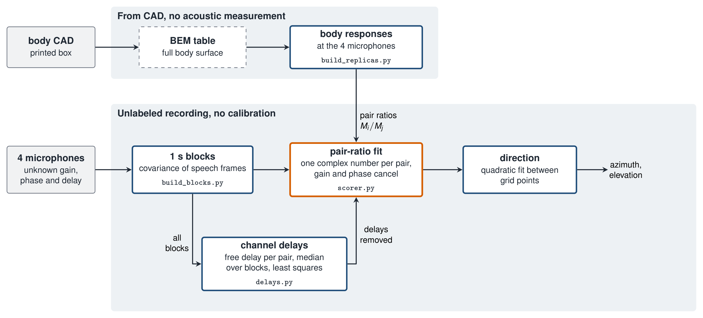

# Calibration-Free Sound Localization

Sound source localization on a robot body without manual calibration of the microphone channels. Each channel introduces an unknown gain, phase shift and delay, and conventional calibration needs a known source or labeled recordings for each device. Labeled acoustic data is hard to collect, so a CAD model of the body and unlabeled audio take its place. Research internship at the KIST AI and Robotics Institute, Humanoid Research Center (2026).



## Body responses from CAD

The responses of the four microphones are computed from the body's CAD model with the boundary element method, with no acoustic measurement (`build_replicas.py`).

## Matching microphone-pair ratios

The recording is matched to the computed responses through the ratios between microphone pairs. A constant gain and phase on each channel only scale a pair ratio by one complex number, which the scorer fits and removes, so the channels need no calibration (`scorer.py`).

## Delays estimated without labels

On a body, a change of direction changes more than the delay, so direction and channel delay can be separated. The channel delays stay fixed across 1 s blocks while the source direction varies, so pooling the blocks estimates the delays without labels (`delays.py`).

## Results

A 3D-printed box with four microphones was measured from 264 directions.

- With unknown channel delays added, the median error is 3.7 degrees. SRP-PHAT without calibration gives 48.4 degrees.
- With the delays recovered from 10 s of unlabeled audio, the median error is 4.2 degrees.

On the public LOCATA recordings, the error is 5.7 degrees with the body model, against 7.9 degrees with a free-field model.

## Run

```sh
pip install -r requirements.txt
python build_replicas.py BEM_TABLE.h5    # data/box_replicas.npz
python build_blocks.py RECORDINGS_DIR    # data/box_blocks.npz
python locate.py                         # channel delays, then one direction per block
```

The BEM table and the recordings are not part of the repository.
